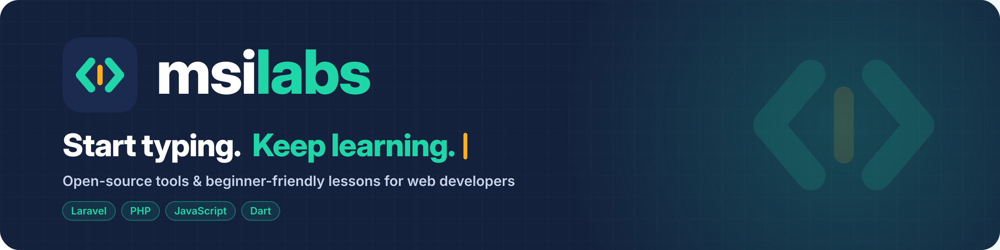

<p align="center">
  
</p>

<h3 align="center">Open-source tools & beginner-friendly lessons for web developers</h3>

<p align="center">
  <a href="https://github.com/msilabs">GitHub</a> ·
  <a href="https://www.linkedin.com/company/msilabs">LinkedIn</a>
</p>

---

## 📦 Packages

| Package | What it does | Install |
|---|---|---|
| [**msilabs/bkash**](https://github.com/msilabs/bkash) | bKash Tokenized Checkout for **Laravel** — create, execute, query and refund payments with a simple Facade. | `composer require msilabs/bkash` |
| [**@msilabs/bkash**](https://github.com/msilabs/bkash-js) | Server-side bKash Tokenized Checkout v2 client for **Node.js, Bun, Deno** and edge runtimes. No runtime dependencies, TypeScript types included. | `npm install @msilabs/bkash` |

**msilabs/bkash** (Laravel)

<p>
  <a href="https://packagist.org/packages/msilabs/bkash"></a>
  <a href="https://packagist.org/packages/msilabs/bkash"></a>
  <a href="https://github.com/msilabs/bkash"></a>
  <a href="https://packagist.org/packages/msilabs/bkash"></a>
</p>

**@msilabs/bkash** (Node.js / TypeScript)

<p>
  <a href="https://www.npmjs.com/package/@msilabs/bkash"></a>
  <a href="https://www.npmjs.com/package/@msilabs/bkash"></a>
  <a href="https://github.com/msilabs/bkash-js"></a>
  <a href="https://www.npmjs.com/package/@msilabs/bkash"></a>
</p>

### Quick look

**Laravel**

```php
use Msilabs\Bkash\Facades\Bkash;

$payment = Bkash::createPayment(
    amount: 500,
    invoiceNumber: 'INV-1001',
    callbackUrl: route('bkash.callback'),
);

return redirect($payment->redirectUrl());
```

**Node.js / TypeScript**

```ts
import { BkashClient } from '@msilabs/bkash'

const bkash = new BkashClient('primary', {
  sandbox: true,
  appKey: process.env.BKASH_APP_KEY!,
  appSecret: process.env.BKASH_APP_SECRET!,
  username: process.env.BKASH_USERNAME!,
  password: process.env.BKASH_PASSWORD!,
})

const payment = await bkash.createPayment({
  amount: 500,
  invoiceNumber: 'INV-1001',
  callbackUrl: 'https://example.com/bkash/callback',
})
```

> These are community, open-source packages. They are not official bKash products.

---

## 🎓 Learn with us

We make short animated explainers for **new developers**: one idea per post, with real code.

**Laravel for beginners:** Folder Structure · MVC · Routing · Blade · Migrations · Eloquent · Request Lifecycle · Middleware · and more

Coming later: **PHP**, **JavaScript** and **Dart** series.

👉 Follow along on [LinkedIn](https://www.linkedin.com/company/msilabs).

---

## 🤝 Contributing

Issues, ideas and pull requests are welcome on any repository.
Found a bug? Open an issue with steps to reproduce. Have a question? Start a discussion.

<p align="center"><sub><b>msilabs</b> · Start typing. Keep learning.</sub></p>
